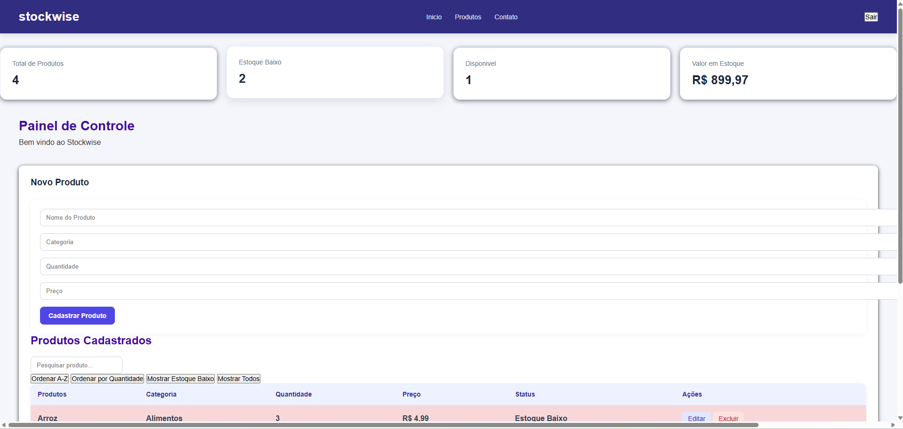
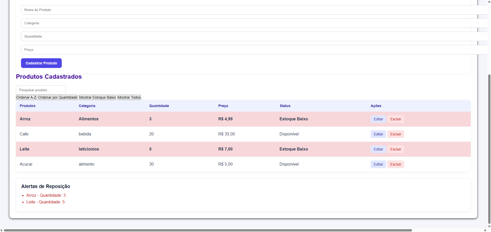

# Stockwise

Sistema de gerenciamento de estoque desenvolvido como projeto pratico durante meus estudos de Analise e desenvolvimento de sistemas.

## ✨ Funcionalidades

- 📦 **Cadastro de produtos:** adição de novos itens ao estoque.
- ✏️ **Edição e exclusão de produtos:** atualização e remoção de itens cadastrados.
- 🔎 **Pesquisa de produtos:** localização rápida de produtos.
- 🔤 **Ordenação alfabética:** organização dos produtos por nome.
- 📊 **Ordenação por quantidade:** organização conforme a quantidade disponível.
- ⚠️ **Filtro de estoque baixo:** identificação de produtos com pouca quantidade.
- 📈 **Indicadores de estoque:** acompanhamento das informações do estoque.
- 🔔 **Alertas de reposição:** aviso sobre produtos que precisam ser repostos.
- 💾 **Armazenamento local com LocalStorage:** salvamento dos dados no navegador.
- 📱 **Interface responsiva:** adaptação da interface a diferentes tamanhos de tela.

## Tecnologias
-HTML5
-CSS3
-JavaScript

## Status do Projeto
-Em desenvolvimento.

Novas funcionalidades e melhorias estao sendo implementadas.

